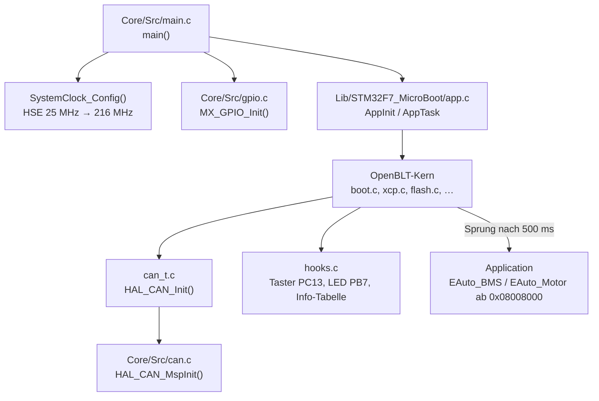
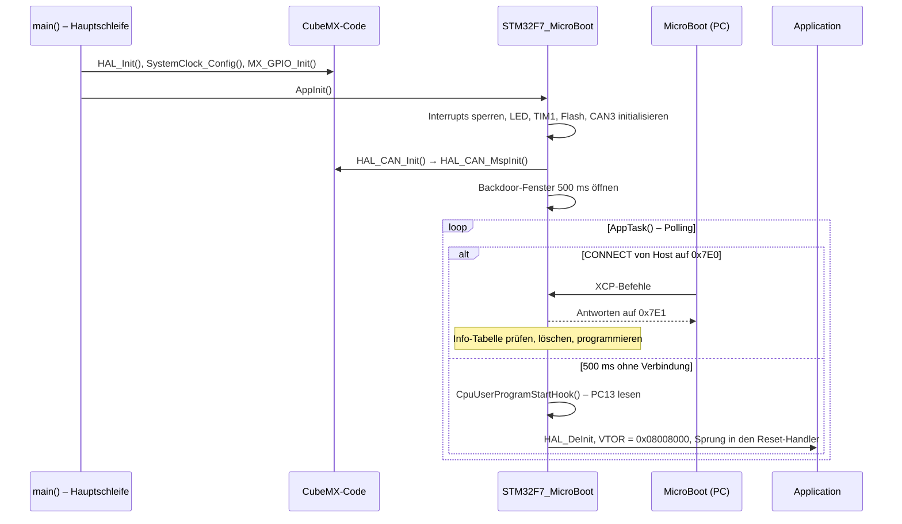

# Architektur EAuto MicroBootloader

Das Projekt verbindet die CubeMX-Initialisierung des STM32F767ZIT mit dem OpenBLT-Bootloader aus
der Bibliothek STM32F7_MicroBoot. Bootloader und Application teilen sich den Flash und laufen
nacheinander auf demselben Steuergerät. Wie der Bootloader intern arbeitet (XCP, Flash-Treiber,
Hook-Funktionen), steht in der
[Architektur der Bibliothek](https://github.com/Diveturtle93/STM32F7_MicroBoot/blob/develop/ARCHITECTURE.md).

## Komponenten

| Modul | Datei(en) | Aufgabe |
|-------|-----------|---------|
| Einstieg | `Core/Src/main.c` | HAL, Takt und GPIO initialisieren, danach `AppInit()` und in der Hauptschleife `AppTask()` |
| Takt | `SystemClock_Config()` in `main.c` | LL-Treiber: HSE 25 MHz, PLL auf 216 MHz, Overdrive, Flash-Latenz 7 |
| GPIO | `Core/Src/gpio.c/.h` | Ports takten, alle freien Pins auf Analog |
| CAN3-MSP | `Core/Src/can.c/.h` | `HAL_CAN_MspInit()`: Takt von CAN3, PA8/PA15 als AF11. `MX_CAN3_Init()` bleibt ungenutzt |
| Bootloader | `Lib/STM32F7_MicroBoot/` | OpenBLT-Kern, CAN3 mit XCP, Flash-Treiber, Hook-Funktionen, Konfiguration in `blt_conf.h` |
| HAL-Konfiguration | `Core/Inc/stm32f7xx_hal_conf.h` | aktiviert u. a. CAN, Flash, GPIO, RCC und Cortex |
| Version | `Core/Inc/version.h` | `VERSION_MAJOR`, `_MINOR`, `_PATCH`, `_DEV` des Projekts |
| Startup, Linker | `Core/Startup/startup_stm32f767zitx.s`, `STM32F767ZITX_FLASH.ld` | Vektortabelle ab `0x08000000`, Speicheraufteilung |

## Datenfluss

### Start nach einem Reset

Nach einem Update startet der Bootloader die Application über `PROGRAM_RESET` direkt. Der genaue
Ablauf der XCP-Befehle steht in der Architektur der Bibliothek.

## Speicher und Ressourcen

### Flash

| Bereich | Adresse | Inhalt | Festgelegt in |
|---------|---------|--------|---------------|
| Sektor 0 | `0x08000000`–`0x08007FFF` | dieser Bootloader (32 kB) | `flashLayout[]` in `flash.c` der Bibliothek |
| Boot-Block | `0x08008000`–`0x080081FF` | Vektortabelle der Application (`0x1F8` Byte), dahinter die Checksumme | Startup-Datei der Application |
| Info-Tabelle | `0x08008200`–`0x0800820B` | `tableId`, `productId`, `firmwareVersion` | `BOOT_INFO_TABLE_ADDR` in `blt_conf.h`, Linker-Skript der Application |
| Application | bis `0x081FFFFF` | EAuto_BMS oder EAuto_Motor, Sektoren 1–11 | Linker-Skript der Application |

Das Linker-Skript dieses Projekts begrenzt den Bootloader nicht auf 32 kB (`LENGTH = 2048K`), siehe
[README, Hinweise](README.md#hinweise).

### RAM

| Bereich | Größe | Zweck |
|---------|-------|-------|
| RAM `0x20000000` | 512 kB | Daten, Heap `0x200`, Stack `0x400` |
| `.shared` | 64 Byte | Shared Parameters der Bibliothek, im Linker-Skript nicht eingetragen |

### Peripherie

| Peripherie | Verwendung |
|------------|------------|
| CAN3 (PA8, PA15) | XCP mit 500 kBit/s, Empfang über FIFO0 im Polling |
| TIM1 | Millisekunden-Zeitbasis der Bibliothek, vor dem Sprung zurückgesetzt |
| SysTick | von `HAL_Init()` gestartet, läuft wegen gesperrter Interrupts nicht, `HAL_GetTick()` kommt aus TIM1 |
| PB7 | LED der Bibliothek, derzeit Analog |
| PC13 | Taster-Abfrage der Bibliothek, auf den Platinen `POWER_ON`, derzeit Analog |
| Flash-Controller | Löschen und Programmieren über die HAL |

## Nebenläufigkeit

Es gibt keine. `AppInit()` sperrt alle Interrupts, und alles läuft aus `AppTask()` in der
Hauptschleife von `main()`. CAN-Empfang, Timer und Backdoor-Fenster werden gepollt. Erst unmittelbar
vor dem Sprung in die Application gibt die Bibliothek die Interrupts wieder frei.

## Erweiterung

| Aufgabe | Ansatzpunkt |
|---------|-------------|
| Andere CAN-IDs oder Baudrate | `blt_conf.h` der Bibliothek, Einstellungen in MicroBoot und im Runbook mitziehen |
| Weitere Platine mit anderer Pinbelegung | CubeMX-Projekt (`EAuto_MicroBootloader.ioc`), für LED und Taster `led.c` und `hooks.c` der Bibliothek |
| Update aus der laufenden Application anstoßen | Shared Parameters: Application setzt ein Byte, Bootloader wertet es in `BackDoorEntryHook()` aus, siehe [Erweiterung der Bibliothek](https://github.com/Diveturtle93/STM32F7_MicroBoot/blob/develop/ARCHITECTURE.md#erweiterung) |
